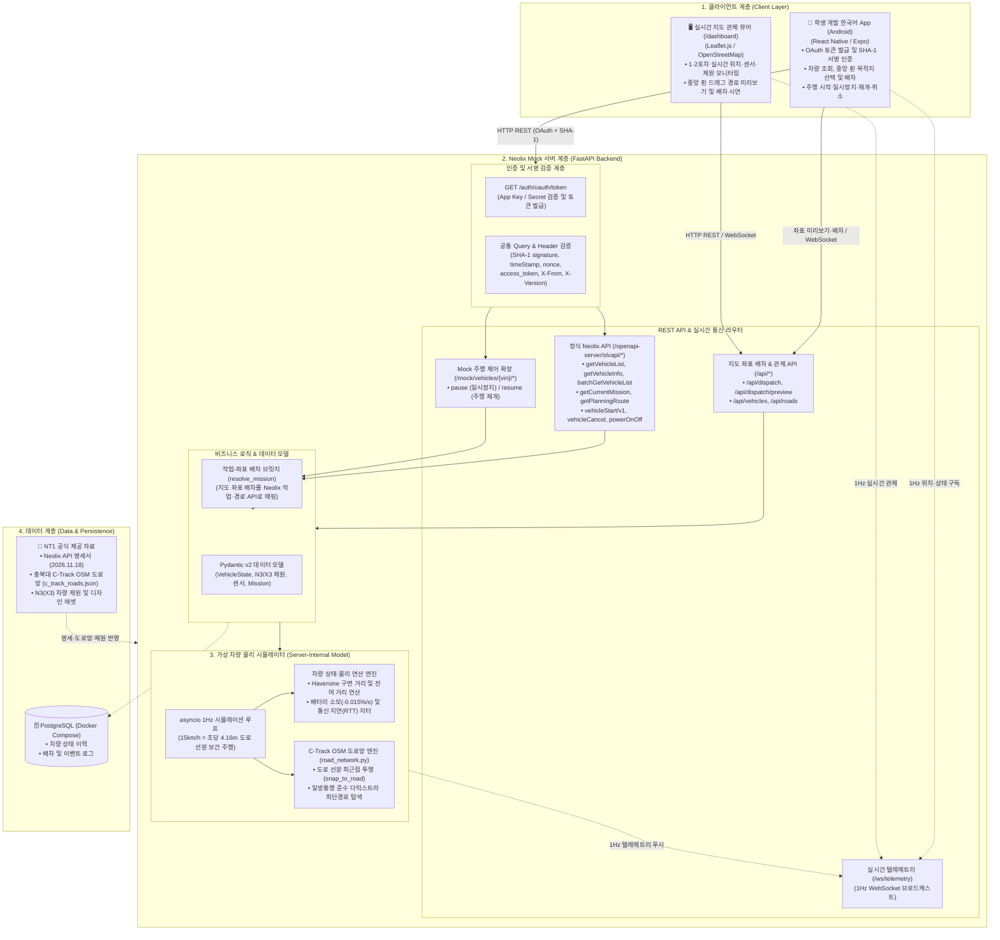

# NT1 자율주행 관제 시스템 (가천대학교 산학 실습 프로젝트)

> **가천대학교 실습 프로젝트**  
> Neolix 가상 자율주행 차량 관제 및 시뮬레이션 시스템

---

## 🏛 SW Architecture (시스템 구성도)



---

## 📌 프로젝트 구조 (Repository Structure)

본 저장소는 모바일 관제 앱과 가상 관제 Mock 서버를 함께 관리하는 모노레포(Monorepo) 프로젝트입니다.

```text
NT1-project/
├── app/                        # [앱팀] React Native (Expo) 모바일 관제 앱
├── server/                     # [서버팀] FastAPI 기반 Mock 관제 서버 & C-Track 가상 주행 시뮬레이터
│   ├── app/                    # 서버 소스코드 (시뮬레이터, REST API, 대시보드)
│   ├── tests/                  # 비동기 E2E 단위 테스트
│   ├── Dockerfile              # 서버 도커 빌드 파일
│   ├── docker-compose.yml      # FastAPI + PostgreSQL 실행 환경
│   └── README.md               # 서버 실행 및 Swagger/대시보드 사용 설명서
├── docs/
│   └── APP_SERVER_INTEGRATION.md # 앱–서버 연동 가이드 및 공통 동작 규칙 명세서
├── progress/                   # 팀원별 일일 진행 상황 및 작업 일지
│   ├── README.md               # 일지 작성 가이드 및 템플릿
│   ├── choi_sujeong.md         # 최수정 작업 일지 (서버/시뮬레이션)
│   ├── han_seunggyu.md         # 한승규 작업 일지 (서버/API)
│   ├── hwang_dayoung.md        # 황다영 작업 일지 (앱/프론트엔드)
│   └── han_jeonghyeok.md       # 한정혁 작업 일지 (앱/백엔드·통신)
├── TEAM_RULES.md               # 팀 협업 규칙 및 Conventional Commits 가이드
└── README.md                   # 통합 프로젝트 개요 및 안내
```

---

## 🛠 파트별 담당 및 기술 스택

### 📱 앱 (Front-end)
* **담당**: 황다영, 한정혁
* **위치**: `app/`
* **스택**: TypeScript, React Native (Expo), React Navigation, react-native-maps

### 🚗 서버 & 시뮬레이터 (Back-end)
* **담당**: 최수정(시뮬레이션 엔진), 한승규(Mock 통신 & API)
* **위치**: `server/`
* **스택**: Python 3.11, FastAPI, asyncio, Pydantic v2, Docker Compose, Leaflet.js
* **실시간 대시보드**: [http://localhost:8000/dashboard](http://localhost:8000/dashboard)
* **Swagger API 문서**: [http://localhost:8000/docs](http://localhost:8000/docs)

---

## 🤝 팀 협업 및 커밋 규칙

* 모든 커밋은 Conventional Commits 표준을 준수합니다. 세부 규칙은 [TEAM_RULES.md](./TEAM_RULES.md)를 참고해 주세요.
* 매일 작업 후 본인의 작업 일지를 [progress/](./progress/) 폴더 내 마크다운 파일에 기록합니다.
