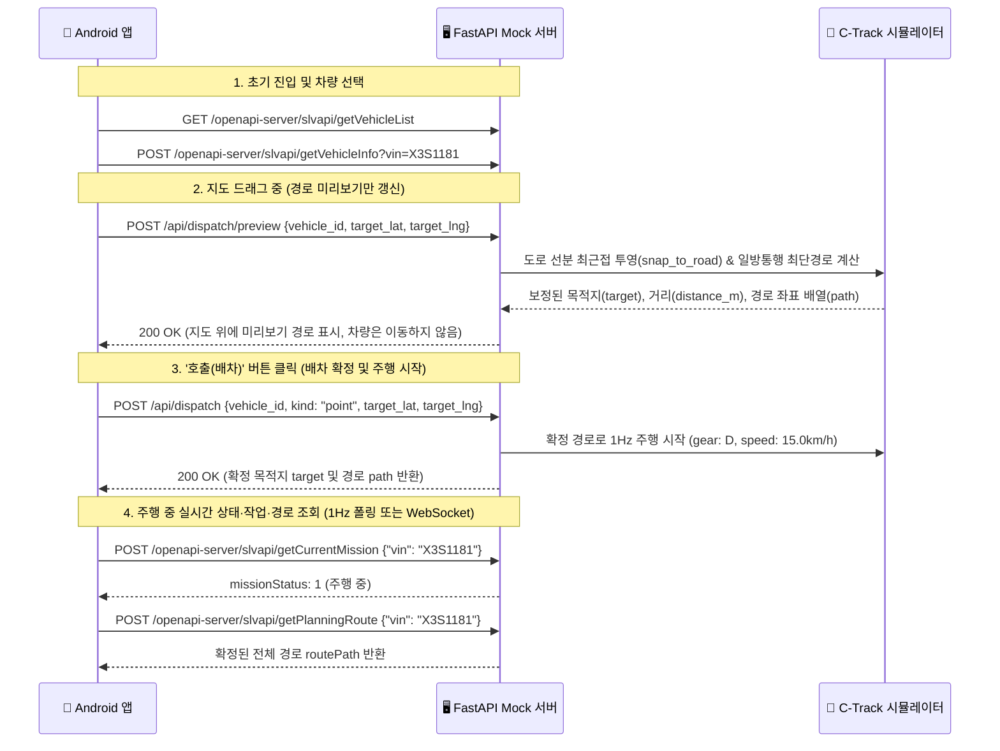

# 🔗 앱–서버 연동 가이드 및 공통 동작 규칙 (Integration & Operation Rules)

> **문서 목적**: NT1 제공 `API_명세서.docx` (2026.11.18) 및 `11/18 개발 방향 안내`에서 앱·서버팀 간 합의를 요청한 **인증 규격, 지도 중앙 핀 좌표 배차 연동 흐름, 주행 제어(일시정지·재개·취소·전원) 상태 전이 규칙, 화면 표시 기준(거리·네트워크 지연·고장 상태)**을 정의한 공통 명세서입니다.

---

## 1. 기본 연결 및 인증 규격 (Authentication & Headers)

* **서버 기본 주소 (`MOCK_BASE_URL`)**: `http://<서버_LAN_IP>:8000` (에뮬레이터: `http://10.0.2.2:8000`)
* **시험용 계정 기본값** (서버 환경변수 `MOCK_APP_ID`, `MOCK_APP_SECRET`으로 변경 가능):
  * `client_id`: `student-mock-app`
  * `client_secret`: `student-mock-secret`
  * `grant_type`: `client_credentials`

### 1.1 토큰 발급
* **요청**: `GET /auth/oauth/token?grant_type=client_credentials&client_id=student-mock-app&client_secret=student-mock-secret`
* **응답**:
  ```json
  {
    "access_token": "<발급된_토큰>",
    "token_type": "bearer",
    "expires_in": 3600,
    "scope": "all"
  }
  ```

### 1.2 업무 API 공통 Query 및 Header
토큰 발급을 제외한 `/openapi-server/slvapi/*` 및 `/mock/vehicles/*` 하위 모든 API 호출 시 아래 값을 필수로 포함합니다.

| 구분 | 필드명 | 형식 / 규칙 | 예시 |
|---|---|---|---|
| **Query** | `access_token` | 발급받은 토큰 문자열 (유효기간 3,600초) | `eyJ...` |
| **Query** | `timeStamp` | **초 단위(10자리)** Unix 타임스탬프 문자열 (응답의 `occurTimestamp`는 ms 단위이므로 구분) | `"1763950000"` |
| **Query** | `nonce` | `10` ~ `99` 사이의 **두 자리 정수** 문자열 | `"42"` |
| **Query** | `signature` | `[client_secret, timeStamp, nonce]` 3개 문자열을 **사전순(lexicographical) 정렬** 후 구분자 없이 이어 붙인 뒤 계산한 **UTF-8 SHA-1 소문자 16진수(40자)** | `"a94a8fe5..."` |
| **Header** | `X-From` | 호출 주체 식별자 (공백이 아닌 문자열 필수) | `"student-android"` |
| **Header** | `X-Version` | 앱 버전 (`A.B.C` 형식, 생략 시 기본값 `0.0.0`) | `"1.0.0"` |

---

## 2. 지도 중앙 핀 드래그 & 좌표 배차 연동 흐름

NT1 11/18 가이드라인(*"카카오T처럼 지도 중앙에 핀을 두고 지도를 드래그하여 선택 → 최근접 경로 위 지점으로 보정 및 실시간 경로 계산 표시 → 호출 버튼 클릭 시 배차 확정 및 이동"*)을 구현하기 위한 API 호출 순서입니다.



### 2.1 경로 미리보기 (지도 드래그 시)
* **Endpoint**: `POST /api/dispatch/preview`
* **Body**: `{"vehicle_id": "X3S1181", "target_lat": 36.7278, "target_lng": 127.4412}`
* **동작 규칙**:
  * 사용자가 지도를 움직여 중앙 핀 좌표가 바뀔 때 호출합니다 (Debounce 또는 이동 종료 시 호출 권장).
  * 선택 위치가 도로를 벗어나도 서버가 C-Track OSM 도로망의 가장 가까운 도로 선분 위로 자동 보정(`target`)하고, 차량 현재 위치부터 보정된 목적지까지의 일방통행 최단경로(`path`)와 총 거리(`distance_m`)를 반환합니다.
  * **이 단계에서는 차량 상태가 변하지 않으며 미리보기 선만 갱신합니다.**

### 2.2 배차 확정 및 주행 시작 (호출 버튼 클릭 시)
* **Endpoint**: `POST /api/dispatch`
* **Body**: `{"vehicle_id": "X3S1181", "kind": "point", "target_lat": 36.7278, "target_lng": 127.4412}`
* **동작 규칙**:
  * 호출 즉시 차량이 `gear = "D"`, `speed = 15.0` (km/h)로 전환되며 초당 1회(1Hz, 약 4.16m/s) 확정 경로를 따라 이동합니다.
  * 배차가 생성되면 정식 Neolix API인 `getCurrentMission`과 `getPlanningRoute`에도 해당 작업이 자동으로 연결됩니다.
  * 좌표 배차 시 `getCurrentMission`의 `startStationId`, `endStationId`는 고정 정류장과 구분하기 위해 **작업 전용 음수 ID**(예: `-2`, `-3`)가 부여됩니다.

---

## 3. 차량 상태 및 주행 제어 공통 규칙 (State Transition Rules)

앱과 서버는 전원, 배차, 일시정지, 재개, 취소 요청 시 아래의 동일한 상태 전이 규칙을 적용합니다. 조건에 맞지 않는 제어 요청 시 서버는 HTTP `409 Conflict` (`code: "MOCK_STATE"`)를 반환합니다.

### 3.1 작업 상태 코드 (`missionStatus`)
`POST /openapi-server/slvapi/getCurrentMission` 응답의 `missionStatus` 값 기준:

| 코드 | 상태명 | 차량 기어 / 속도 | `getPlanningRoute` 응답 | 비고 |
|:---:|:---:|:---:|:---:|---|
| `null` | 작업 없음 | `P` / `0.0 km/h` | `data: []` | 서버 기동 후 최초 배차 전 (`data: null`) |
| **`1`** | **주행 중** | `D` / `15.0 km/h` | 확정된 경로 배열 반환 | 1초마다 위치 보간 이동 및 배터리 `-0.015%/s` 소모 |
| **`2`** | **일시정지** | `P` / `0.0 km/h` | 확정된 경로 배열 유지 | 현재 위치에서 정차, 남은 경로 유지 |
| **`3`** | **도착 완료** | `P` / `0.0 km/h` | `data: []` | 목적지 도착 시 자동 전환 (다음 배차 전까지 `3` 유지) |
| **`4`** | **작업 취소** | `P` / `0.0 km/h` | `data: []` | 취소 또는 비상정차 시 전환 (다음 배차 전까지 `4` 유지) |

### 3.2 제어 명령별 동작 및 제약 규칙

| 기능 | 호출 API | 허용 조건 | 상태 변화 및 제약 규칙 |
|---|---|---|---|
| **주행 일시정지** | `POST /mock/vehicles/{vin}/pause` | 작업 주행 중 (`missionStatus == 1`) | • `missionStatus`: `1` → `2`<br/>• `speed`: `15.0` → `0.0`, `gear`: `D` → `P` |
| **주행 재개** | `POST /mock/vehicles/{vin}/resume` | 작업 일시정지 (`missionStatus == 2`) | • `missionStatus`: `2` → `1`<br/>• `speed`: `0.0` → `15.0`, `gear`: `P` → `D` (남은 경로 이어서 주행) |
| **작업 취소** | `POST /openapi-server/slvapi/vehicleCancel?vin={vin}` | **정차 상태** (`speed == 0` / 일시정지 상태) | • **주행 중(`speed > 0`) 바로 취소 요청 시 `409 MOCK_STATE` 거절**<br/>• 반드시 먼저 `pause`로 일시정지한 뒤 `vehicleCancel` 호출<br/>• 취소 시 `missionStatus = 4`, 계획 경로 초기화 |
| **전원 끄기** | `POST /openapi-server/slvapi/powerOnOff`<br/>`{"vin": "...", "handleType": 2}` | **정차 상태** (`speed == 0`) | • **주행 중(`speed > 0`) 전원 Off 요청 시 `409 MOCK_STATE` 거절**<br/>• 일시정지(`2`) 상태에서 전원 Off 시 진행 중이던 작업은 **취소(`4`)** 처리됨<br/>• `driveMode`: `1` → `0` |
| **전원 켜기** | `POST /openapi-server/slvapi/powerOnOff`<br/>`{"vin": "...", "handleType": 1}` | 제한 없음 | • `driveMode`: `0` → `1`<br/>• 이전에 취소된 작업이 자동으로 재개되지 않으며 대기 상태 유지 |

> **참고 (`driveMode` vs `powerState` 구분)**:
> * `driveMode`: 차량 전원 상태 (`1`: 전원 켜짐 / 자율주행 대기·주행 가능, `0`: 전원 꺼짐)
> * `powerState`: 차량 네트워크 온라인 연결 여부 (`true`: 온라인, `false`: 오프라인)
> * `vehicleAvailable` (`batchGetVehicleList`): `0` = 배차 이용 가능 (전원 ON + 온라인 + 진행 중 작업 없음), `1` = 이용 불가

---

## 4. 앱 화면 표시 및 계산 공통 기준

NT1 11/18 메시지 4번 항목(*"고장 신고 처리 방식, 사용자와의 거리 계산 기준, 네트워크 지연 표시 기준"*)에 대한 앱·서버 공통 규칙입니다.

### 4.1 사용자와의 거리 및 경로 거리 계산 기준
1. **직선 거리 (사용자와 차량 간 거리)**:
   * 지구 반지름 $R = 6,371,000\text{ m}$ 기준 **Haversine 구면 거리 공식**을 동일하게 사용합니다.
   * 사용자(앱) 위치 기준점이 C-Track 외부에 있을 경우(예: 학교·자택에서 테스트 시), C-Track 기본 기준점(`lat: 36.727629, lng: 127.440838`) 또는 선택 차량의 출발 기준점으로부터의 거리를 표시합니다.
2. **주행 경로 거리**:
   * 배차 전: `POST /api/dispatch/preview` 응답의 `distance_m` (미터 단위) 표시
   * 배차 후: `POST /openapi-server/slvapi/getPlanningRoute` 응답의 `distance` (미터 단위) 또는 `/ws/telemetry`의 `task.remaining_distance_m` 표시

### 4.2 네트워크 지연 (Latency / RTT) 표시 기준
* 서버 시뮬레이터는 주행 중 통신 지터(Jitter)를 모사하여 `latency_ms` 값을 실시간으로 갱신합니다 (`GET /api/vehicles` 및 `/ws/telemetry`로 수신 가능, 혹은 앱에서 API 응답 왕복 시간 측정).
* **상태 표시 구간 기준**:
  * **정상 (양호 / 초록색)**: `0 ~ 100 ms` (평상시 시뮬레이터 기본 범위: `20 ~ 120 ms`)
  * **주의 (지연 / 노란색)**: `101 ~ 300 ms`
  * **경고 (통신 불량 / 빨간색)**: `301 ms 이상` 또는 `powerState == false` (오프라인)

### 4.3 센서 상태, 차량 제원 및 고장 신고 처리 기준
* **차량 제원**: NT1 제공 `N3 (X3)` 공식 사양(적재용량 $3\text{ m}^3$, 최대 적재중량 $520\text{ kg}$, 만충 주행거리 $100\text{ km}$, 배터리 $9.6\text{ kWh}$ / $72\text{ V DC}$, 최대 설계속도 $40\text{ km/h}$ 미만, 가상 주행속도 $15\text{ km/h}$, 방수 `IPX5`, 자율주행 `SAE L4`)을 공통 적용합니다 (`GET /api/vehicles`의 `specifications` 필드에 포함).
* **센서 상태**: LiDAR, Radar, Camera, IMU 정상 여부 및 GNSS(`RTK FIX`), 시스템 온도는 시험용 데이터로 제공됩니다 (`GET /api/vehicles`의 `sensors` 필드에 포함).
* **고장 상태 (`faultStatus`) 및 고장 신고**:
  * `POST /openapi-server/slvapi/batchGetVehicleList`의 `faultStatus`는 `0`(정상), `1`(이상/고장)을 반환합니다.
  * **고장 신고 접수 및 해제 Mock 확장 API**: `POST /mock/vehicles/{vin}/fault` (공통 인증 Query/Header 사용)
    * 요청 Body: `{"faultStatus": 1, "reason": "고장 신고 사유"}` (`faultStatus: 0` 전송 시 고장 해제)
    * 고장 신고(`faultStatus = 1`) 접수 시:
      1. 차량이 주행 중(`missionStatus == 1`)이었다면 안전을 위해 즉시 **일시정지(`missionStatus = 2`, `speed = 0`, `gear = P`)**로 전환됩니다.
      2. `batchGetVehicleList` 조회 시 `faultStatus = 1`, `vehicleAvailable = 1`(배차 불가)로 반환되며, 고장이 해제(`faultStatus = 0`)되기 전까지 신규 배차 및 주행 재개(`resume`)가 제한(`409 MOCK_STATE`)됩니다.

### 4.4 구현 제외 항목 (NT1 확정 사항)
차량 상세 화면 중 아래 7개 기능은 Mock 구현 범위에서 공식 제외합니다:
* `10번` 상호작용 / `11번` 영상 모니터링 / `12번` 작업 로그 화면 / `13번` 위치 보정 / `18번` 문 열기 / `19번` 원격 수동 제어 / `20번` 조명

---

## 5. 공통 오류 응답 규격 (Error Codes)

성공 응답은 `"code": "10000"`을 사용하며, 오류 발생 시 아래의 Mock 전용 오류 코드를 반환합니다.

| HTTP Status | `code` | `msg` (한국어 메시지) | 발생 조건 |
|:---:|---|---|---|
| `200` | `"10000"` | `"성공"` | 정상 처리 |
| `401` | `"MOCK_AUTH"` | `"Mock 인증 실패"` | `client_id`/`secret` 불일치, 토큰 만료, `signature` 불일치 |
| `404` | `"MOCK_NOT_FOUND"` | `"차량을 찾을 수 없습니다."` / `"지점을 찾을 수 없습니다."` | 존재하지 않는 `vin` 또는 `stationId` 요청 |
| `409` | `"MOCK_STATE"` | 상태별 상세 사유 반환 | 주행 중 취소/전원 Off 시도, 오프라인/전원 Off 차량 배차 시도 등 |
| `422` | `"MOCK_INVALID"` | `"요청 필드 또는 형식 오류"` | 필수 Query/Header(`X-From`, `timeStamp`, `nonce`) 누락 또는 타입 불일치 |
